# Forecasting Renewable Energy Production in Madeira Island

[](https://www.python.org/)
[](LICENSE)
[]()

A synthetic-data reproduction of the modeling pipeline behind the manuscript **"Forecasting Renewable Energy Production in Madeira Island,"** submitted to *Cleaner Energy Systems* (Elsevier).

### Contents

1. [Motivation](#1-motivation)
2. [Data](#2-data)
3. [Repository structure](#3-repository-structure)
4. [Pipeline](#4-pipeline)
5. [Results](#5-results)
6. [License](#6-license)
7. [Contact](#7-contact)

## 1. Motivation

Madeira, a small Portuguese island in the Atlantic, has no interconnection to a larger grid, so the hydropower, wind, solar and biomass it produces have to be balanced locally against fossil and natural-gas generation. Better forecasts of renewable production help the grid operator plan storage and backup and reduce fossil-fuel standby. This project uses machine learning to forecast daily renewable production on the island.

This started as my master's thesis in Data Science and Advanced Analytics at NOVA IMS, built on real operational data from EEM (Empresa de Eletricidade da Madeira), the island's utility, shared with me under a confidentiality arrangement. I built and compared four modeling approaches, LSTM, MLP, Random Forest, and XGBoost, across all four renewable sources. The results held up well enough, and felt useful enough beyond an academic exercise, that my supervisors, Maria Anastasiadou and Vitor Santos, and I decided to take it further and turn it into a peer-reviewed article. This repository is the part of that work I can make public.

The full thesis is open access: [NOVA RUN repository](https://run.unl.pt/entities/publication/21a7783f-52e1-4096-a626-2cc963cef5d9). The article's results come from a later re-run of the thesis pipeline, so some numbers in the thesis differ from those in the article.

## 2. Data

None of the data under `data/` is real. `synthetic_production.csv` and the two `synthetic_weather_*.csv` files come out of `generate_synthetic_data.py`, a generator that mimics the structure of the real datasets (same columns, timestamps, diurnal patterns, skew and missing-value patterns) without containing any real record. It was calibrated with aggregate statistics only: installed capacity, monthly seasonal shapes and distributional properties profiled from the real data. The only real values in this repository are aggregates: the real monthly means in the chart below and the published results in section 5.

The chart below compares synthetic and real monthly means. The synthetic data follow solar closely and hydropower roughly (with too much production in summer), but they do not reproduce the seasonality of wind and biomass:

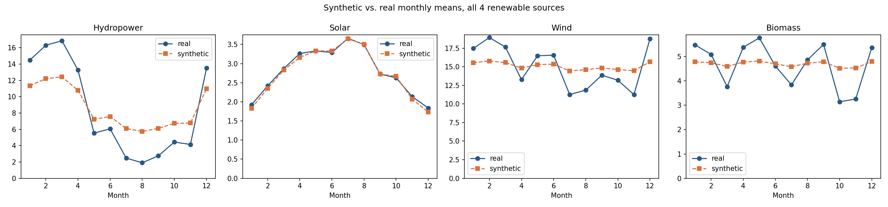

Because of this, every result this pipeline produces (feature importances, R², RMSE, MAE, SHAP values) comes from synthetic data and **will not match the numbers in the article**, which come from the confidential EEM and weather data. This repository lets a reader check that the methodology described in the article is implemented as described and runs end to end; it does not reproduce the article's findings.

The real data are not included for two reasons:

- **Production data**: it belongs to EEM, shared with me under a confidentiality arrangement for the thesis. EEM had no objection to the thesis becoming a journal article, but that did not extend to publishing the underlying data or the original analysis notebooks.
- **Weather data**: pulled from the Visual Crossing Weather API. It isn't confidential, but its license prohibits republishing raw records in bulk, and the full historical pull used in the study is well beyond the API's free-tier query caps.

Synthetic data avoid both problems and still let anyone run the pipeline. Each script's docstring states which section of the article it corresponds to. The synthetic data generator and the public scripts were prepared with the assistance of Claude (Anthropic) and checked by the authors against the original analysis.

## 3. Repository structure

```
forecasting-renewable-energy-production-madeira-island/
├── generate_synthetic_data.py        # Builds the 3 synthetic CSVs below from calibrated distributions
├── synthetic_vs_real_seasonal.png    # Validation chart: synthetic vs. real seasonal profile
├── data/
│   ├── synthetic_production.csv              # Synthetic EEM production, 15-min resolution
│   ├── synthetic_weather_FW_Funchal.csv       # Synthetic weather, Funchal station, hourly
│   ├── synthetic_weather_LPMA.csv             # Synthetic weather, LPMA station, hourly
│   └── processed/                             # Output of pipeline/01-04 (generated locally; only final/ is tracked in git)
│       ├── <target>_{train,val,test,trainval,test_tv}.csv
│       ├── <target>_xgb_importance.csv
│       ├── scalers/                           # Fitted scikit-learn scalers (joblib)
│       └── final/                             # Output of pipeline/05
│           └── <target>/{model.joblib, metrics.json, line_chart.png, shap_beeswarm.png}
├── real_results/                     # Real-data charts from the published manuscript (see section 5)
│   └── <target>/{line_chart.png, shap_beeswarm.png}
├── pipeline/
│   ├── 01_merge_data.py              # Merge production + weather
│   ├── 02_preprocess.py              # Cleaning, split, cyclical encoding, imputation
│   ├── 03_feature_engineering.py     # Daily aggregation, lags, rolling means
│   ├── 04_scale_and_select.py        # Scaling + XGBoost-based feature selection
│   ├── 05_train_final_models.py      # Final-round model training + SHAP
│   └── requirements.txt
└── colab/
    └── synthetic_data_repo_real_xgboost.ipynb   # Colab runner for 04 and 05 (see 4.2)
```

## 4. Pipeline

Run the scripts in order from the repo root:

```bash
pip install -r pipeline/requirements.txt

python3 generate_synthetic_data.py --out ./data
python3 pipeline/01_merge_data.py
python3 pipeline/02_preprocess.py
python3 pipeline/03_feature_engineering.py
python3 pipeline/04_scale_and_select.py
python3 pipeline/05_train_final_models.py
```

Each script reads the previous one's output from `data/` and writes its own output back there. The final step produces, for each of the four targets (Solar, Wind, Hydropower, Biomass), a trained model, its evaluation metrics, an actual-vs-predicted line chart, and a SHAP beeswarm summary plot, under `data/processed/final/<target>/`, plus a combined `data/processed/final/final_summary.csv`.

### 4.1 Models

The study evaluated LSTM, MLP, Random Forest and XGBoost over three rounds. LSTM was dropped after round 1 (it was not the best model for any source, given the limited data) and MLP after round 2 (signs of overfitting, and SHAP is slow and only approximate for neural networks). In the final round, **XGBoost** performed best for Hydropower and Wind and **Random Forest** for Solar and Biomass. `05_train_final_models.py` reproduces this final round with the hyperparameters listed in the article's Table 4. Rounds 1 and 2 are not included in this repository.

### 4.2 Environment notes

`04_scale_and_select.py` and `05_train_final_models.py` use `xgboost` for feature selection and, for two of the four targets, for the final model. `05_train_final_models.py` also uses `shap` for the explainability plots. Both scripts fall back to pure scikit-learn equivalents (`GradientBoostingRegressor` in place of `XGBRegressor`, skipping the SHAP plot) if `xgboost`/`shap` aren't installed, and this always gets reported explicitly in the output (`xgboost_available`, `shap_available` flags) instead of failing. If you have trouble installing `xgboost`/`shap`, `colab/synthetic_data_repo_real_xgboost.ipynb` is a Google Colab notebook that installs them and runs steps 01 to 04; run `pipeline/05_train_final_models.py` afterwards in the same session. The committed results in `data/processed/final/` were produced with `xgboost` and `shap` installed.

### 4.3 A note on feature selection results

On the synthetic data, the automatic selection in `04_scale_and_select.py` picks `Fossil` and `Natural Gas` generation for Wind and Biomass (written to `data/processed/<target>_xgb_importance.csv` when the pipeline runs). This comes from the synthetic generator, which drives all production columns with similar seasonal signals and so creates correlations between sources that are not physically meaningful. In the article, the final feature lists (Table 1) contain no non-renewable variables.

### 4.4 Sanity check: pipeline output on synthetic data

Running the pipeline on the synthetic data shows that it executes end to end and that each step produces output of the expected shape. The table below shows the results of that run (`data/processed/final/final_summary.csv`). These numbers have no scientific meaning: they depend on the synthetic generator and should not be compared with the article (section 5 has the published results).

| Target | Model | R² | RMSE | MAE |
|---|---|---|---|---|
| Solar | Random Forest | 0.951 | 2.35 | 1.88 |
| Wind | XGBoost | 0.756 | 14.19 | 11.12 |
| Hydropower | XGBoost | 0.951 | 13.99 | 10.74 |
| Biomass | Random Forest | 0.876 | 2.68 | 2.06 |

<table>
<tr>
<td>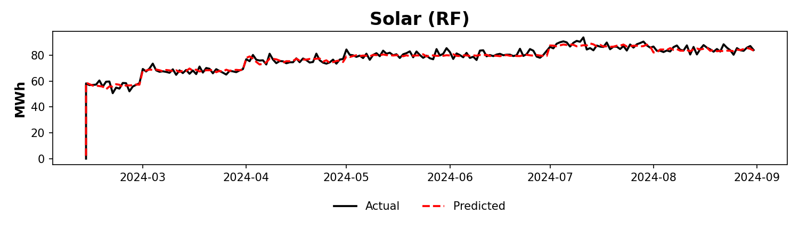</td>
<td>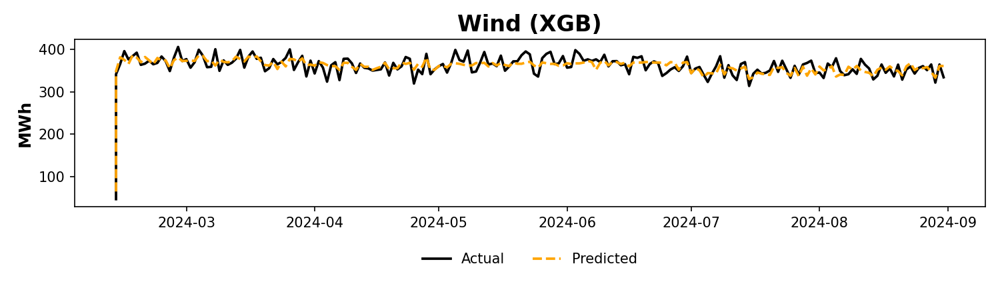</td>
</tr>
<tr>
<td>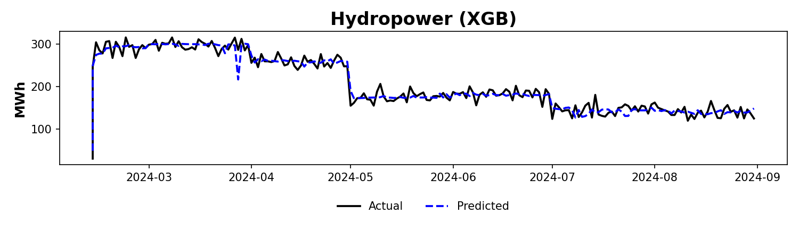</td>
<td>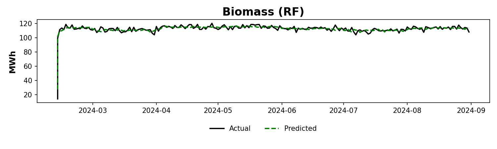</td>
</tr>
</table>

Each target's folder under `data/processed/final/` also has a SHAP beeswarm plot (`shap_beeswarm.png`) showing which features actually drove that model's predictions on the synthetic data.

## 5. Results

Final-round metrics reported in the article (Table 4), obtained on the real, confidential EEM production and weather data. They cannot be reproduced with this repository, since the real data are not included (section 2).

| RES | Model | MAE (MWh) | RMSE (MWh) | R² |
|---|---|---|---|---|
| Solar | Random Forest | 12.9 | 15.8 | 0.33 |
| Wind | XGBoost | 142.8 | 188.0 | 0.68 |
| Hydropower | XGBoost | 27.2 | 42.1 | 0.94 |
| Biomass | Random Forest | 8.8 | 16.9 | 0.75 |

<table>
<tr>
<td>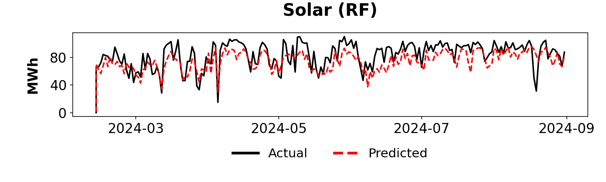</td>
<td>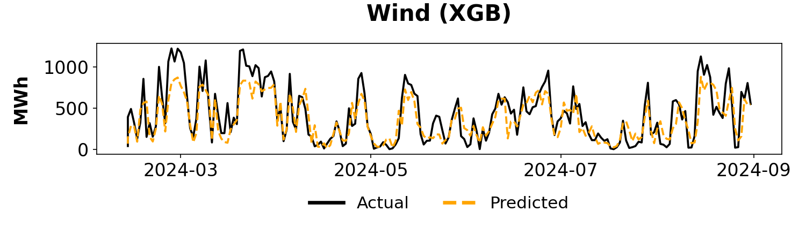</td>
</tr>
<tr>
<td>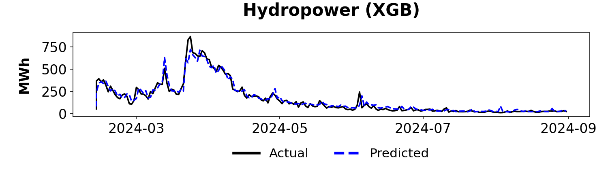</td>
<td>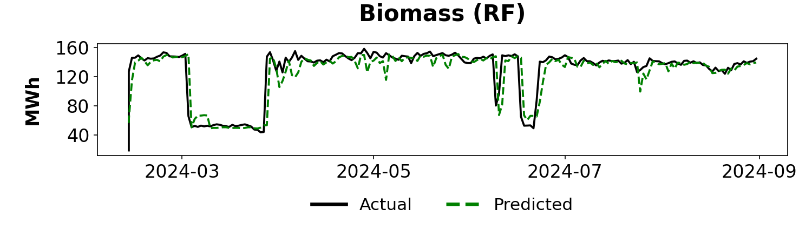</td>
</tr>
</table>

<table>
<tr>
<td>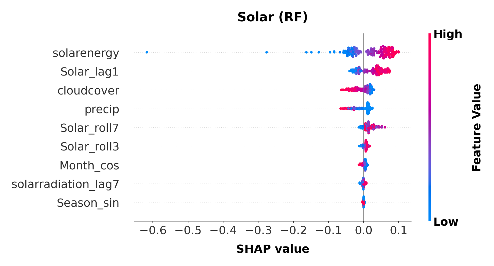</td>
<td>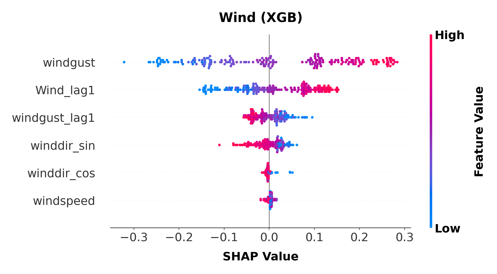</td>
</tr>
<tr>
<td>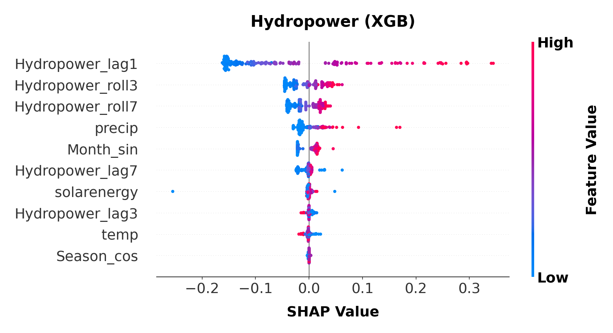</td>
<td>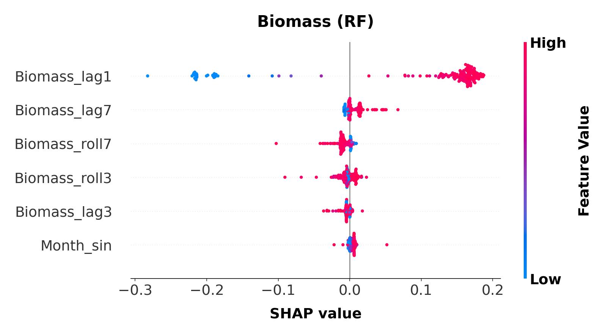</td>
</tr>
</table>

## 6. License

The code in this repository (`generate_synthetic_data.py`, everything under `pipeline/`, and the Colab notebook) is released under the MIT License, see `LICENSE`. The synthetic datasets under `data/` are released under the same terms; use them freely, including for your own experiments or teaching, with the understanding that they're synthetic and don't represent real measurements.

## 7. Contact

If you use this code or the synthetic datasets, please cite the article:

> G. Ferreira, M. Anastasiadou and V. Santos, "Forecasting Renewable Energy Production in Madeira Island," *Cleaner Energy Systems* (Elsevier), under review. Full citation details will be added once the article is published.

Questions or problems with the code can be raised in the [Issues](https://github.com/Gl-ferreira/forecasting-renewable-energy-production-madeira-island/issues) tab of this repository.
